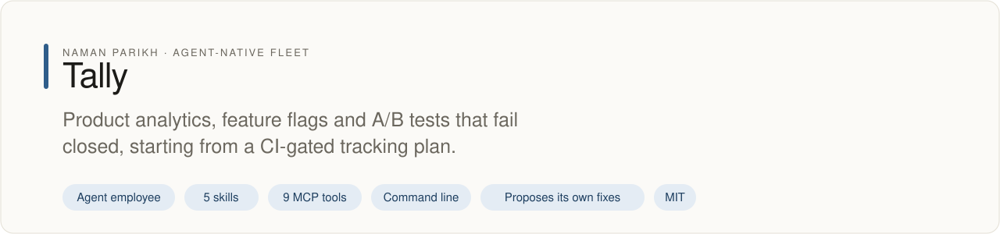
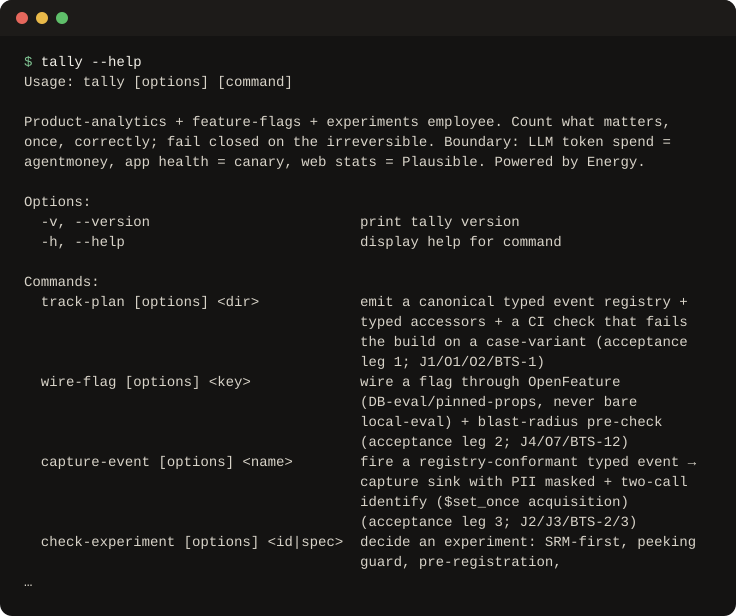

# tally

<!-- fleet:header:start -->
<p align="center"><picture><source media="(prefers-color-scheme: dark)" srcset="assets/banner-dark.svg"></picture></p>

<p align="center">
<a href="https://github.com/naman10parikh/tally/actions/workflows/ci.yml"></a>
<a href="https://github.com/naman10parikh/tally/releases"></a>
<a href="LICENSE"></a>
<a href="#use-it-from-any-coding-agent"></a>
<a href="https://x.com/naman10parikh"></a>
<a href="https://www.linkedin.com/in/naman-parikh1/"></a>
</p>

<p align="center"><a href="#quick-start">Quick start</a> · <a href="docs/README.md">How it works</a> · <a href="AGENTS.md">AGENTS.md</a> · <a href="llms.txt">llms.txt</a> · <a href="skills/">Skills</a> · <a href="https://github.com/naman10parikh/tally/discussions">Discussions</a> · <a href="https://github.com/naman10parikh">All projects</a></p>

**Product analytics, feature flags and A/B tests that fail closed, starting from a CI-gated tracking plan.**

Tally is an agent employee, a packaged specialist agent with its own skills, memory and tests. It owns one job: analytics and feature flags. Coding agents use it through its skills, its MCP server and its command line. A scheduled job runs its evals and proposes fixes. A person makes every change.

_Tally is part of an agent-native play for agent-native systems that can eventually be recursively self-improving and evolving, operated by agent employees._

<p align="center"></p>
<!-- fleet:header:end -->

## What it is

tally runs product analytics, feature flags and A/B tests for coding agents. It counts what matters,
once, correctly: the tracking plan becomes a CI-gated event registry, flags go through OpenFeature
safely, PII is masked before it leaves the app, and a peeked or broken experiment never ships as a
winner. It is for teams and agents that ship product features and need numbers they can trust; it blocks
the silent mistakes that no alert would ever catch, instead of warning about them.

<!-- fleet:use:start -->
## Use it from any coding agent

**Claude Code**: the plugin brings the skills, sub-agents, hooks and MCP server.

```
/plugin marketplace add naman10parikh/tally
/plugin install tally@tally
```

<details><summary>Its MCP server, Codex, Cursor, Gemini CLI, one skill and the command line</summary>

**Its MCP server**, in any MCP client:

```bash
claude mcp add --transport stdio tally -- npx -y -p github:naman10parikh/tally tally-mcp
codex mcp add tally -- npx -y -p github:naman10parikh/tally tally-mcp
```

Cursor (`.cursor/mcp.json`), Gemini CLI (`.gemini/settings.json`) and most other clients take the same command as JSON:

```json
{
  "mcpServers": {
    "tally": {
      "command": "npx",
      "args": [
        "-y",
        "-p",
        "github:naman10parikh/tally",
        "tally-mcp"
      ]
    }
  }
}
```

**Gemini CLI**: the extension brings the context and the MCP server.

```bash
gemini extensions install https://github.com/naman10parikh/tally
```

**One skill** (5 in all, in [skills/](skills/)), in any agent that reads Agent Skills:

```bash
gemini skills install https://github.com/naman10parikh/tally --path skills/design-tracking-plan
git clone --depth 1 https://github.com/naman10parikh/tally /tmp/tally && cp -r /tmp/tally/skills/design-tracking-plan ~/.claude/skills/
```

**The command line:**

```bash
npx -y -p github:naman10parikh/tally tally --help
```

</details>

Codex, Cursor, OpenCode, GitHub Copilot and other agents read [AGENTS.md](AGENTS.md); Claude Code reads [CLAUDE.md](CLAUDE.md) and Gemini CLI reads [GEMINI.md](GEMINI.md), which import it. [llms.txt](llms.txt) maps every surface for agents that read first.
<!-- fleet:use:end -->

## Quick start

You need Node.js 22 or later and pnpm.

```bash
git clone https://github.com/naman10parikh/tally && cd tally
pnpm install && pnpm build

# Turn an app's events into a registry plus a CI check that fails the build on a case-variant event
node bin/tally.js track-plan eval/fixtures/sample-app --app demo --out ./plan

# Refuse to call a winner on a peeked A/B test (exits 3: the refusal is the answer)
node bin/tally.js check-experiment eval/fixtures/peeked-test.json

# Capture a typed event with PII masked at the edge (the email is stored as ***)
node bin/tally.js capture-event checkout_started --props '{"plan":"pro","email":"a@b.com"}' --sink local --out ./capture/events.jsonl

# Wire a flag through OpenFeature with database evaluation, never bare local evaluation
node bin/tally.js wire-flag new_checkout --provider flagd --target distinct_id --db-eval

# Read one pitfall from the brain by its ID
node bin/tally.js explain P27

# Run the tests and the evals (L1 structural, L2 behavioral, L3 trajectory)
pnpm test && pnpm eval
```

Without a clone, `npx -y -p github:naman10parikh/tally tally --help` runs the command line straight
from GitHub.

## How it works

- **The tracking plan is code.** `tally track-plan` turns an app's events into a canonical registry,
  typed accessors and a CI check. The check fails the build on an unregistered, case-variant or
  type-changed event.
- **Flags that cannot surprise you.** `tally wire-flag` uses database evaluation or pinned properties,
  never bare local evaluation (where one user can get two values), and checks the blast radius first.
  `tally flag-sweep` finds zombie flags and refuses to reuse a retired key.
- **No fake winners.** `tally check-experiment` checks sample-ratio mismatch first, then peeking,
  pre-registration and multiple comparisons. It refuses (exit 3) rather than advise.
- **PII never reaches the store.** `tally capture-event` masks PII at the edge and identifies users in
  two calls; `tally audit-pii` scans the four places PII hides.
- **Operate as an agent.** `tally read` uses typed queries and materializes recurring reads, so an agent
  never loops raw HogQL into PostHog's 120-per-hour cap. `tally migrate-plan` dual-writes and explains
  the delta.
- **Stay in its lane.** LLM token spend belongs to agentmoney, app health to canary, and web traffic
  stats to a privacy web-stats tool such as Plausible.

The default stack is PostHog, OpenFeature, flagd (the free, local flag loop), GrowthBook when an
experiment needs deeper statistics, and Plausible CE for web stats. The brain in `brain/` holds 8 jobs,
20 opinions, 27 pitfalls and 17 battle-tested scenarios; `tally brain "<query>"` searches it with BM25
and `tally explain <id>` prints one entry. A person can open the local cockpit with `pnpm serve`
(http://127.0.0.1:7788). It is built on the Energy harness formula: one repository is one agent
employee, with its identity, memory, skills, hooks, sub-agents and MCP server inside it.

<!-- fleet:anatomy:start -->
## What it is made of

Every project in this fleet is graded on the same 11 harness components and on self-improvement. Each mark is backed by a file you can open.

| Component | Grade | Where |
| --- | --- | --- |
| Identity | ✅ | identity/SOUL.md:9 |
| Memory | ✅ | MEMORY.md:1, src/memory/bm25.ts:2, memory/LEARNINGS.md:5 |
| Skills | ✅ | skills/experiment-rigor/SKILL.md:1 (5 skills) |
| Tools/CLIs | ✅ | package.json:7, src/cli/index.ts:213 |
| Hooks | ✅ | .claude/settings.json:4, hooks/hooks.json:3 |
| Sub-agents | ✅ | .claude/agents/taxonomy-pii-auditor.md:2, .claude/agents/experiment-stats-reviewer.md:2 |
| MCPs | ✅ | src/mcp/tools/index.ts:55, .mcp.json:3 |
| Dispatch | ✅ | src/dispatch/route.ts:75, .github/workflows/rsi.yml:11 |
| Evals | ✅ | eval/l1, eval/l2, eval/l3, .github/workflows/acceptance.yml:86 |
| Observability | ✅ | src/observability/run-logger.ts:120 |
| Sandbox/Infra | ✅ | eval/sandbox/acceptance-e2b.mjs:106 |
| Self-improvement | ✅ | dsip.json:5, .github/workflows/rsi.yml:11, .github/workflows/rsi.yml:44 |

✅ real and tested · 🟡 partial, with the reason in the row · ❌ absent
<!-- fleet:anatomy:end -->

<!-- fleet:footer:start -->
## How it improves itself

It carries its own evals and a self-improvement contract, [`dsip.json`](dsip.json), which says what it may change and how a change is judged. A scheduled job runs its evals and proposes fixes. A person makes every change. Lessons it learns are kept as rules in its memory files.

## Part of a fleet

One of the projects by [Naman Parikh](https://github.com/naman10parikh). Each owns one part of an agent's harness, or of the product around an agent, and all of them follow one standard.

| Related project | What it owns |
| --- | --- |
| [AgentDial](https://github.com/naman10parikh/agentdial) | Identity |
| [WikiMem](https://github.com/naman10parikh/wikimem) | Memory |
| [Skillsmith](https://github.com/naman10parikh/skillsmith) | Skills |
| [Agent Booster](https://github.com/naman10parikh/agent-booster) | Tools / CLIs |
| [Armory](https://github.com/naman10parikh/armory) | MCPs and the component registry |
| [AgentGrid](https://github.com/naman10parikh/agentgrid) | Dispatch |
| [AgentSwarm](https://github.com/naman10parikh/agentswarm) | Dispatch |
| [AgentBench](https://github.com/naman10parikh/agentbench) | Evals |
| [AgentMoney](https://github.com/naman10parikh/agentmoney) | Observability |
| [Claude Harness](https://github.com/naman10parikh/claude-harness) | The whole harness, as a template |

## Community

Questions and ideas go to [Discussions](https://github.com/naman10parikh/tally/discussions); bugs go to [issues](https://github.com/naman10parikh/tally/issues/new/choose). Follow the work on [X](https://x.com/naman10parikh) and [LinkedIn](https://www.linkedin.com/in/naman-parikh1/).

## Contributing and security

Read [CONTRIBUTING.md](CONTRIBUTING.md). AI-assisted pull requests are welcome. Report a vulnerability privately, as [SECURITY.md](SECURITY.md) explains.

## License

MIT, © 2026 Naman Parikh. See [LICENSE](LICENSE) and [NOTICE](NOTICE).
<!-- fleet:footer:end -->
