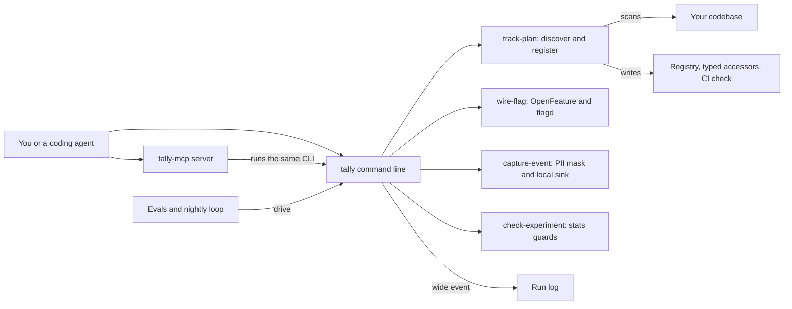

# How Tally works

Tally is a product analytics and feature flag helper for developers and coding agents.
It starts from a tracking plan: one typed list of the events a product records.
Tally builds that list from your code, wires feature flags through OpenFeature, and captures events with personal data masked.
OpenFeature is an open standard for feature flag calls, so the flag vendor can change without a rewrite.
Tally also checks experiment results and refuses to call a winner when the numbers cannot support one.
Every command runs locally, with no model and no key.

## The parts



The command line is [bin/tally.js](../bin/tally.js).
It runs the compiled `dist/cli/index.js`, or the TypeScript source through tsx in a fresh checkout.
[src/cli/index.ts](../src/cli/index.ts) wires eleven commands, each calling a `run` function in [src/commands/](../src/commands/).
The MCP server in [src/mcp/server.ts](../src/mcp/server.ts) offers 9 tools over standard input and output.
MCP, the Model Context Protocol, lets an agent call tools by name.
Each tool shells out to the same command line through [src/mcp/run-cli.ts](../src/mcp/run-cli.ts), so both give the same answers and refusals.

Event discovery and the registry live in [src/registry/](../src/registry/).
Flag wiring writes a file-backed flagd source through [src/flags/openfeature-adapter.ts](../src/flags/openfeature-adapter.ts).
[src/capture/pii-mask.ts](../src/capture/pii-mask.ts) drops personal fields before [src/capture/local-sink.ts](../src/capture/local-sink.ts) writes an event.
The experiment checks in [src/stats/](../src/stats/) cover sample ratio mismatch, a sign the traffic split is broken, plus peeking and multiple comparisons.
Every run appends a wide event, one JSON line with a trace id and a duration, through [src/observability/run-logger.ts](../src/observability/run-logger.ts).
The evals in [eval/](../eval/) and the loop in [workflows/rsi.workflow.js](../workflows/rsi.workflow.js) drive the command line to catch regressions.

## What happens when you run it

The main flow builds a tracking plan from a codebase: `tally track-plan ./my-app --app shop`.

1. [bin/tally.js](../bin/tally.js) starts the program, and [src/cli/index.ts](../src/cli/index.ts) parses the arguments with commander.
2. `runTrackPlan` in [src/commands/track-plan.ts](../src/commands/track-plan.ts) starts a run record. A missing folder stops here with an error.
3. `discoverEvents` in [src/registry/discover.ts](../src/registry/discover.ts) scans source files for event capture calls. It skips `node_modules`, `dist` and other build folders.
4. `buildRegistry` merges case and format variants, such as "Checkout Started" and "checkout_started", into one snake_case name.
5. It joins the properties of the merged events, infers their types, and marks first-touch properties as `$set_once`, so later events never overwrite them.
6. It writes `registry.json`, `events.ts` and `ci-check-events.mjs` into `.tally-plan/`, or into the `--out` folder.
7. Each file goes to a temporary path first and is then renamed, so an interrupted run leaves no half-written file.
8. `ci-check-events.mjs` is a script for your CI. It fails the build when code sends an unregistered or case-variant event.
9. Tally prints the paths and how many variants it merged, or JSON with `--json`. The run record lands in `logs/runs.jsonl` inside the Tally folder.

In CI, [.github/workflows/acceptance.yml](../.github/workflows/acceptance.yml) runs this flow on [eval/fixtures/sample-app/](../eval/fixtures/sample-app/) and plants a variant to prove the check fails.
The same job wires a flag, captures an event with personal data masked, and checks that a peeked experiment is refused.

## Extending it

- **A command.** Add a `run` function in [src/commands/](../src/commands/) that prints through [src/commands/output.ts](../src/commands/output.ts). Register it in `buildProgram` in [src/cli/index.ts](../src/cli/index.ts).
- **An MCP tool.** Add a `ToolDef` to `TOOLS` in [src/mcp/tools/index.ts](../src/mcp/tools/index.ts), with a Zod input shape and a `toArgv` function that maps it to a command. [tests/mcp-server.test.ts](../tests/mcp-server.test.ts) checks the tool list.
- **A statistics guard.** Add a pure function to [src/stats/](../src/stats/) and call it from [src/commands/check-experiment.ts](../src/commands/check-experiment.ts). Add a fixture under [eval/fixtures/](../eval/fixtures/).
- **A skill.** Create `skills/<name>/SKILL.md` with `name` and `description` front matter, like [skills/design-tracking-plan/SKILL.md](../skills/design-tracking-plan/SKILL.md).
- **An eval.** Add a test to [eval/l1/structural.test.ts](../eval/l1/structural.test.ts) or [eval/l2/behavioral.test.ts](../eval/l2/behavioral.test.ts). Use the `tally` helper in [eval/harness.ts](../eval/harness.ts) to run the command line.

Run these before you push:

```bash
pnpm install
pnpm build
pnpm test
pnpm eval
pnpm test:e2e
```

## Questions

**Does it need an API key or cost money?**
No key is needed for any command, the MCP server or the evals.
`wire-flag` defaults to flagd, a local file, and `capture-event` defaults to a local JSONL file.
The optional sandbox test in [eval/sandbox/acceptance-e2b.mjs](../eval/sandbox/acceptance-e2b.mjs) needs `E2B_API_KEY`, on your own E2B account. Without a key it skips.

**Does any data leave the machine?**
The commands make no web requests.
With `MCP_HTTP=1`, the MCP server listens over HTTP on `PORT`, 8765 by default, on all network interfaces.
The nightly loop calls `gh api` to check whether one upstream repository was archived.
The cockpit in [web/server.mjs](../web/server.mjs) listens on 127.0.0.1 only.

**How does it improve itself?**
[dsip.json](../dsip.json) declares the `agent` level, with a nightly loop and no self-grading.
[.github/workflows/rsi.yml](../.github/workflows/rsi.yml) runs `node workflows/rsi.workflow.js --deterministic` every day at 09:17 UTC.
The loop rechecks facts that move, such as a vendor rate limit and archived repositories, and proves its drift check fires on planted stale values.
It runs `tally eval`, writes a proposal under `.rsi/proposals/`, and CI uploads it for a person to review.
The loop never commits. The model half that would write improvements is not built yet.

**How do I run its tests or evals?**
`pnpm test` runs Vitest over [tests/](../tests/) and [eval/](../eval/).
`pnpm eval` runs `tally eval`, which runs Vitest. Pass `--level 1`, `2` or `3` to run one level's folder.
Level 3 holds the plan-graded tasks, which do not block CI.
`pnpm test:e2e` runs the Playwright tests for the command line and the cockpit.

**What does it not do?**
The `posthog` capture sink is not built yet. `capture-event --sink posthog` says so and exits 1, and it sends and stores nothing.
`read` and `migrate-plan` print queries and plans. They do not connect to an analytics service.
It does not track LLM token spend or app health.
The routing loop in [src/dispatch/route.ts](../src/dispatch/route.ts) runs the acceptance steps in order, but only its tests call it today.
